# Medallion Lakehouse Pipeline Architecture (Databricks Serverless)

This document establishes the official engineering standard for **Databricks Medallion Lakehouse Pipelines** in the V-Energy Grid 360 ecosystem.

---

## 🏛️ Medallion Architecture Overview

```mermaid
flowchart LR
    subgraph Sources["Raw Files (CSV / ZIP)"]
        S1["clientes"]
        S2["contratos"]
        S3["medidores"]
        S4["faturamento"]
        S5["medicao"]
        S6["interrupcoes"]
        S7["chamados"]
        S8["transformadores"]
    end

    subgraph Bronze["Bronze Layer (Raw Delta)"]
        B["Preserva conteúdo bruto\n+ _ingested_at\n+ _source_file"]
    end

    subgraph Silver["Silver Layer (Cleansed Delta)"]
        S["Tipagem correta\nDeduplicação\nTratamento de Nulos\nIntegridade Referencial"]
    end

    subgraph Gold["Gold Layer (Star Schema Marts)"]
        G1["dim_cliente / dim_tempo / dim_alimentador"]
        G2["fato_faturamento / fato_medicao"]
        G3["fato_interrupcoes (DEC/FEC ANEEL)"]
        G4["fato_inspecoes_perdas"]
    end

    subgraph Export["Local SQLite Mart"]
        DB[("v_energy.db\nLocal SQLite WAL")]
    end

    Sources --> Bronze
    Bronze --> Silver
    Silver --> Gold
    Gold -->|Export Script / SQLite Dump| DB
```



---

## 🥉 1. Bronze Layer Guidelines (`Landing_to_Bronze.ipynb`)

1. **Zero Content Modification:**
   - Raw columns and schemas must remain intact. Do not rename, cast types, or filter invalid rows in Bronze.
2. **Mandatory Audit Metadata:**
   - Append technical metadata columns to every Bronze table:
     ```python
     from pyspark.sql import functions as F

     df_bronze = (
         spark.read.option("header", "true")
         .option("inferSchema", "false")
         .csv(f"{landing_path}/{table_name}.csv")
         .withColumn("_ingested_at", F.current_timestamp())
         .withColumn("_source_file", F.input_file_name())
     )
     df_bronze.write.format("delta").mode("overwrite").saveAsTable(f"bronze_{table_name}")
     ```

---

## 🥈 2. Silver Layer Guidelines (`Bronze_to_Silver.ipynb`)

1. **Strict Type Casting & Standardization:**
   - Dates cast to `DateType` / `TimestampType` with explicit format parsing.
   - Financial and energy values cast to `DecimalType(18, 4)` or `DoubleType`.
   - String fields trimmed and normalized.
2. **Deduplication Strategy:**
   - Identify canonical primary keys (e.g., `id_uc`, `id_fatura`, `id_chamado`) and resolve duplicate entries deterministically (e.g., `row_number() over (partition by id order by data_atualizacao desc)`).
3. **Referential Integrity Enforcement:**
   - Cleanse or isolate orphan foreign keys (e.g., measurement or billing records referencing non-existent consumer units). Log orphan counts for quality reporting.

---

## 🥇 3. Gold Layer Guidelines (`Silver_to_Gold.ipynb`)

1. **Dimensional Modeling (Star Schema):**
   - Separate business entities into **Dimensions** (`dim_cliente`, `dim_alimentador`, `dim_calendario`) and **Facts** (`fato_faturamento`, `fato_medicao`, `fato_interrupcoes_qualidade`).
2. **Regulatory Metric Computation (DEC & FEC ANEEL):**
   - **DEC (Duração Equivalente de Interrupção por Unidade Consumidora):**
     $$\text{DEC} = \frac{\sum (t \times C_{\text{int}})}{C_{\text{total}}}$$
     Onde $t$ é a duração da interrupção (em horas), $C_{\text{int}}$ é o número de unidades consumidoras interrompidas e $C_{\text{total}}$ é o total de unidades atendidas pelo alimentador.
   - **FEC (Frequência Equivalente de Interrupção por Unidade Consumidora):**
     $$\text{FEC} = \frac{\sum C_{\text{int}}}{C_{\text{total}}}$$
   - Ambas as métricas devem ser pré-calculadas e indexadas por alimentador e período mensal na Gold.

---

## ⚙️ 4. Databricks Workflow Orchestration (`job.yaml`)

Use declarative multi-task Workflows with explicit DAG dependencies, timeouts, and automated retries:

```yaml
name: v_energy_grid_360_lakehouse_pipeline
schedule:
  quartz_cron_expression: 0 0 4 1 * ? # Mensal, às 04:00 AM
  timezone_id: America/Recife
  pause_status: UNPAUSED
tasks:
  - task_key: Task_Landing_to_Bronze
    notebook_task:
      notebook_path: /Workspace/V_Energy_Analytics/Landing_to_Bronze
      source: WORKSPACE
    timeout_seconds: 3600
    max_retries: 2
    min_retry_interval_millis: 60000

  - task_key: Task_Bronze_to_Silver
    depends_on:
      - task_key: Task_Landing_to_Bronze
    notebook_task:
      notebook_path: /Workspace/V_Energy_Analytics/Bronze_to_Silver
      source: WORKSPACE
    timeout_seconds: 3600
    max_retries: 2
    min_retry_interval_millis: 60000

  - task_key: Task_Silver_to_Gold
    depends_on:
      - task_key: Task_Bronze_to_Silver
    notebook_task:
      notebook_path: /Workspace/V_Energy_Analytics/Silver_to_Gold
      source: WORKSPACE
    timeout_seconds: 3600
    max_retries: 2
    min_retry_interval_millis: 60000

  - task_key: Task_Export_Gold_to_SQLite
    depends_on:
      - task_key: Task_Silver_to_Gold
    notebook_task:
      notebook_path: /Workspace/V_Energy_Analytics/Export_Gold_to_SQLite
      source: WORKSPACE
    timeout_seconds: 1800
    max_retries: 1

format: MULTI_TASK
max_concurrent_runs: 1
```

---

## 💾 5. Gold-to-SQLite Export Pipeline

To serve the local FastAPI backend and the embedded Text-to-SQL agent:
- Read consolidated Gold Delta tables into Pandas or DuckDB.
- Write into `backend/v_energy.db` using SQLite with proper indexes on key query fields:
  ```python
  import sqlite3
  import pandas as pd

  def export_gold_to_sqlite(gold_tables: dict[str, pd.DataFrame], db_path: str):
      with sqlite3.connect(db_path) as conn:
          conn.execute("PRAGMA journal_mode=WAL;")
          conn.execute("PRAGMA synchronous=NORMAL;")
          for table_name, df in gold_tables.items():
              df.to_sql(table_name, conn, if_exists="replace", index=False)
              print(f"Exported {table_name}: {len(df)} rows")
          
          # Create analytical indexes
          conn.execute("CREATE INDEX IF NOT EXISTS idx_fato_fat_uc ON fato_faturamento(id_uc);")
          conn.execute("CREATE INDEX IF NOT EXISTS idx_fato_qualidade_alim ON fato_qualidade(id_alimentador);")
  ```
