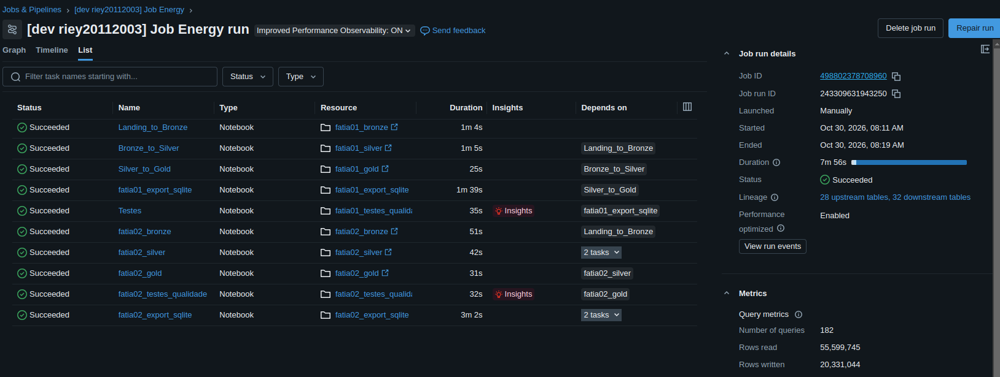

# ⚡ V-Energy Grid 360

Plataforma inteligente de análise de dados e indicadores regulatórios do setor elétrico brasileiro (DEC, FEC, consumo, tarifas e mercado). A solução integra um **Portal Web moderno em React 19** com um **Agente Analítico de Inteligência Artificial Text-to-SQL (FastAPI + LangGraph)** que responde em português perguntas de negócio sobre os dados, mostrando o SQL e a tabela usados em cada resposta.

Diagnóstico da queda de receita (a pergunta central do case): [`docs/DIAGNOSTICO_RECEITA.md`](docs/DIAGNOSTICO_RECEITA.md).

## 📁 Organização do repositório e decisões arquiteturais

O repositório oficial da solução é o [GitHub do time](https://github.com/msb7-jpg/visagio-atividade-v-energy-360). A estrutura versionada reflete os módulos realmente implementados:

| Diretório / arquivo | Responsabilidade |
|---|---|
| [`data-engineering/`](data-engineering/) | Notebooks Bronze → Silver → Gold, testes de qualidade e configuração do Workflow Databricks |
| [`backend/`](backend/) | API FastAPI, regras de negócio, acesso ao SQLite e agente Text-to-SQL |
| [`frontend/`](frontend/) | Portal web React 19 e TypeScript |
| [`docs/`](docs/) | [`Dicionário de dados`](docs/DATA_DICTIONARY.md), [`diagnóstico da receita`](docs/DIAGNOSTICO_RECEITA.md), decisões arquiteturais e evidências |
| [`README.md`](README.md) | Configuração, execução local, demonstração e suposições da solução |

O agente de IA está em [`backend/app/agent/`](backend/app/agent/), integrado ao backend para compartilhar autenticação, banco e implantação; por isso, não há um diretório `ai-agent/` separado. Os arquivos brutos do case não são versionados: obtenha `base_dados_1.zip` e `base_dados_2.zip` conforme as instruções da equipe antes de executar a carga local.

| Decisão | Motivo e consequência |
|---|---|
| Monorepositório organizado em fatias verticais | Mantém pipeline, API, interface e documentação da solução no repositório oficial, com responsabilidades por domínio. |
| Pipeline Lakehouse Bronze → Silver → Gold | Preserva a origem e trata os dados em camadas; o Workflow executa testes de qualidade e condiciona a exportação final da Fatia 02 à aprovação dos testes das duas fatias. |
| Exportação da Gold para SQLite | Permite ao portal e ao agente consultar localmente os mesmos dados publicados pelo pipeline, sem depender de acesso ao Databricks durante a execução da aplicação. |
| Agente Text-to-SQL integrado à API | Reutiliza a autenticação e o ciclo de implantação do backend; as consultas do agente são somente leitura e limitadas aos dados disponíveis. |
| Portal React 19 separado da API FastAPI | Mantém interface e serviços desacoplados, comunicando-se pelos endpoints HTTP do backend. |

Os detalhes, alternativas consideradas e decisões de domínio estão em [`docs/DECISOES.md`](docs/DECISOES.md). Os passos de configuração e execução de cada módulo estão nas seções abaixo.

---

## 🚀 Como Rodar o Projeto (Guia Rápido)

O projeto é gerenciado via [`Makefile`](Makefile) (Linux/macOS) ou via [`scripts/dev.ps1`](scripts/dev.ps1) (Windows, sem precisar do `make`).

### Pré-requisitos
- [uv](https://docs.astral.sh/uv/) (gerenciador rápido para Python 3.12+); no Windows, `pip install --user uv` também funciona
- [bun](https://bun.sh/) (runtime e gerenciador de pacotes para JavaScript/TypeScript); no Windows, `npm install -g bun` também funciona
- `make` (apenas Linux/macOS)
- Os arquivos `base_dados_1.zip` e `base_dados_2.zip` na raiz do projeto (fora do git)

### Passo a Passo (Linux/macOS)

```bash
# 1. Configurar dependências e ambientes virtuais (backend + frontend)
make setup-all

# 2. Descompactar as bases de dados históricas para data/landing/
make data-unzip

# 3. Iniciar o Backend FastAPI (:8000) com Swagger em http://localhost:8000/docs
make run-backend

# 4. Iniciar o Frontend React 19 (:5173) em http://localhost:5173
make run-frontend
```

### Passo a Passo (Windows / PowerShell)

```powershell
# 1. Instalar dependências do backend e do frontend
powershell -ExecutionPolicy Bypass -File scripts\dev.ps1 setup

# 2. Descompactar as bases para data\landing
powershell -ExecutionPolicy Bypass -File scripts\dev.ps1 data

# 3. Subir backend (:8000, em outra janela) e frontend (:5173) juntos
powershell -ExecutionPolicy Bypass -File scripts\dev.ps1 dev

# Para usar outro banco SQLite (ex: o de testes gerado com o comando "seed"):
powershell -ExecutionPolicy Bypass -File scripts\dev.ps1 seed
powershell -ExecutionPolicy Bypass -File scripts\dev.ps1 dev -Database backend\v_energy_dev.db
```

Demais comandos: `backend`, `frontend`, `lint`, `test` e `check` (lint, testes, TypeScript e build). `scripts\dev.ps1 help` lista todos.

**O banco `backend/v_energy.db` não vai para o Git** (os dados do case são confidenciais). Ele é gerado pelo pipeline: no Databricks ou localmente (ver [Pipeline de Dados](#-pipeline-de-dados-databricks)). Sem ele, a API sobe, mas as telas mostram erro de tabela ausente.

### Logins de demonstração

Todos com a senha `venergy123`. A tela de login também lista as contas no bloco "Acesso de demonstração" (`VITE_DEMO_LOGIN=false` esconde o bloco).

| E-mail | Perfil | O que vê |
|---|---|---|
| `diretor@venergy.com` | Diretor comercial | todas as telas: Painel, Inteligência Comercial, Fila de Inspeção, Qualidade da Rede e Visão 360 |
| `perdas@venergy.com` | Gerente de perdas | Fila de Inspeção e Visão 360 |
| `operacao@venergy.com` | Gerente de operação | Qualidade da Rede e Visão 360 |
| `gerente.atendimento@venergy.com` | Gerente de atendimento | Visão 360 |
| `atendimento@venergy.com` | Atendente | Visão 360 |

O assistente de IA aparece para todos os perfis. O backend recusa (403) qualquer chamada de API fora do perfil, não só o menu. As contas são de demonstração e ficam em [`backend/app/core/config.py`](backend/app/core/config.py), com a senha guardada só como hash Argon2. Não há cadastro de usuários nem SSO: em produção, o login viria do provedor de identidade da empresa e a chave do JWT (`JWT_SECRET_KEY`) de uma variável de ambiente, nunca do valor de exemplo.

### Inteligência Artificial (`backend/.env`)

O agente Text-to-SQL (LangGraph) fica em [`backend/app/agent/`](backend/app/agent/), dentro da API, e não numa pasta `ai-agent/` separada: ele usa a mesma autenticação, o mesmo banco somente leitura e o mesmo deploy do backend. O chat aparece no canto da tela em todas as páginas, e o insight automático fica no Painel do Diretor.

Copie [`backend/.env.example`](backend/.env.example) para `backend/.env` e escolha um provedor:

| Provedor | O que preencher |
|---|---|
| Google Gemini | `GEMINI_API_KEY="..."` e `AI_MODEL_NAME` (o case recomenda o Gemini 3.1 Flash-Lite; o `.env.example` vem com `gemini-2.5-flash-lite`) |
| OpenRouter | `AI_PROVIDER="openrouter"`, `OPENROUTER_API_KEY="..."` e o modelo |
| Modelo local (llama.cpp, `make run-llm`) | `AI_PROVIDER="local"` e `AI_BASE_URL="http://localhost:1234/v1"` |

**Sem nenhum provedor configurado, a IA fica indisponível e avisa:** o chat responde "Assistente de IA indisponível" com o passo a passo acima, e o insight do Painel não aparece. Nada é inventado. Para uma demonstração sem internet, `AI_PROVIDER="mock"` liga respostas fixas, sempre marcadas como "Modo demonstração".

---

## 🧱 Pipeline de Dados (Databricks)

O banco `backend/v_energy.db` usado pelo portal e pela IA é gerado por um pipeline **Bronze → Silver → Gold** no Databricks, orquestrado por um Workflow e exportado em CSV e SQLite.

| Peça | Onde está |
|---|---|
| Notebooks (`.ipynb`) | [`data-engineering/notebooks/`](data-engineering/notebooks/) |
| Workflow (Job) | [`data-engineering/job.yaml`](data-engineering/job.yaml), implantado pelo bundle [`data-engineering/databricks.yml`](data-engineering/databricks.yml) |
| Fonte externa (limites ANEEL de DEC/FEC) | [`data-engineering/reference/aneel_limites_continuidade.csv`](data-engineering/reference/aneel_limites_continuidade.csv) |
| Dicionário de dados da Gold | [`docs/DATA_DICTIONARY.md`](docs/DATA_DICTIONARY.md) |
| Decisões e suposições (ADRs) | [`docs/DECISOES.md`](docs/DECISOES.md) |

Tudo fica no catálogo `visagio_atividade_v_energy_360`, com um schema por camada (`bronze`, `silver`, `gold`). O Workflow roda as tarefas de cada fatia em paralelo quando possível, executa os **testes de qualidade** das duas fatias e só então exporta: se algum teste falhar, o job para e o portal continua com os últimos dados bons.

### Como executar

Pré-requisitos: [Databricks CLI](https://docs.databricks.com/dev-tools/cli/install.html) autenticado (`databricks auth login --host https://<seu-workspace>`) e as bases descompactadas (`make data-unzip`).

```bash
# 1. Criar catálogo, schema e Volume de landing (no Free Edition, rode no SQL Editor do Databricks):
#    CREATE CATALOG IF NOT EXISTS visagio_atividade_v_energy_360;
#    CREATE SCHEMA IF NOT EXISTS visagio_atividade_v_energy_360.bronze;
#    CREATE VOLUME IF NOT EXISTS visagio_atividade_v_energy_360.bronze.landing;

# 2. Enviar os arquivos brutos e a fonte externa da ANEEL para o Volume de landing
databricks fs cp -r data/landing/ dbfs:/Volumes/visagio_atividade_v_energy_360/bronze/landing/ --overwrite
databricks fs cp data-engineering/reference/aneel_limites_continuidade.csv \
  dbfs:/Volumes/visagio_atividade_v_energy_360/bronze/landing/ --overwrite

# 3. Importar os notebooks para uma pasta do workspace
databricks workspace import-dir data-engineering/notebooks /Workspace/V_Energy_Analytics --overwrite

# 4. Implantar e rodar o Workflow (prod mantém a agenda; sem -t prod, o job de teste fica pausado)
cd data-engineering
databricks bundle deploy -t prod --var="notebooks_dir=/Workspace/V_Energy_Analytics"
databricks bundle run -t prod Job_Energy --var="notebooks_dir=/Workspace/V_Energy_Analytics"

# 5. Baixar o banco gerado para o backend
cd ..
databricks fs cp dbfs:/Volumes/visagio_atividade_v_energy_360/gold/exports/v_energy.db backend/v_energy.db --overwrite
```

As tabelas Gold também ficam em CSV (um arquivo por tabela) em `/Volumes/visagio_atividade_v_energy_360/gold/exports/`.

Ao trocar o `backend/v_energy.db`, apague também o `v_energy.db-wal` e o `v_energy.db-shm` da mesma pasta e reinicie a API. O banco fica em modo WAL: um `-wal` do banco antigo faz o SQLite acusar "database disk image is malformed", e o Painel guarda os indicadores em cache.

### Estratégia de agendamento

O Workflow roda **todo dia 1º, às 04h (horário de Recife)**. Faturamento, leituras e indicadores DEC/FEC são fechados por **competência mensal**, então reprocessar uma vez por mês, logo após o fechamento, entrega o mês completo sem gastar computação com dados que não mudaram. A madrugada evita concorrência com o uso do portal, e uma execução por vez (`max_concurrent_runs: 1`) impede que duas cargas gravem o `v_energy.db` ao mesmo tempo.

### Execução bem-sucedida do Workflow

Execução de ponta a ponta do Workflow no Databricks, com todas as tarefas concluídas com sucesso:



### Rodar o pipeline sem o Databricks (opcional)

Os mesmos 10 notebooks também rodam localmente, num Spark com Delta Lake na própria máquina. Cada notebook detecta se está no Databricks (`DATABRICKS_RUNTIME_VERSION`); fora dele, usa [`data-engineering/notebooks/local_runtime.py`](data-engineering/notebooks/local_runtime.py) no lugar do Unity Catalog, dos Volumes e do `dbutils`.

Requisitos: Linux, macOS ou WSL (no Windows nativo, o Spark exige configuração extra do Hadoop), Java 17 e as bases brutas em `data/landing/`.

```bash
cd backend && uv sync --extra pipeline && cd ..
make pipeline-local
```

O banco sai em `data/gold_exports/v_energy.db`, e o `backend/v_energy.db` do portal **não é alterado**. O Spark local não é idêntico ao do Databricks, então confira as contagens que o comando mostra contra o banco oficial antes de publicar com `cp data/gold_exports/v_energy.db backend/v_energy.db` (e apague `backend/v_energy.db-wal` e `backend/v_energy.db-shm`).

---

## 📋 Suposições e Demonstração por Fatia

Cada fatia descreve aqui o que assumiu e como demonstrar o que entregou. As decisões completas, com números e alternativas descartadas, ficam em `docs/`.

### 🗄️ Fatias 01 e 02: Dados (Bronze, Silver e Gold)

Responde à diretora de tecnologia: **um número só para cada coisa**, com a origem de cada métrica explicada. Os oito arquivos brutos passam por Bronze (como vieram), Silver (limpeza) e Gold (tabelas para as perguntas), e os testes de qualidade do Workflow param a exportação se algo sair do contrato. O [dicionário de dados](docs/DATA_DICTIONARY.md) descreve cada tabela e diz qual tabela responde a cada liderança.

**Suposições**

| Suposição | Decisão | Onde está o detalhe |
|---|---|---|
| Datas e textos | datas em seis formatos lidas por cascata; bairro e município sem acento e em maiúsculas; os 61 bairros com dupla codificação (*mojibake*) revertidos | ADR-009 |
| Virada de medidor | medidor de 5 dígitos: leitura anterior de 90.000 ou mais e atual de 10.000 ou menos vira consumo recalculado; recuo fora disso seria anomalia (não ocorre nos dados) | ADR-006 |
| Medidor ativo | o mais recente sem data de retirada | ADR-007 |
| Painel solar | `possui_gd` pelo cruzamento com `geracao_distribuida.csv` | ADR-008 |
| Potência solar | mantida como veio do bruto, em kWp; as 35 UCs acima de 100 kWp (até 8.995) ficam como valor suspeito; nenhum indicador usa a potência, só a Visão 360 a exibe | ADR-029 |
| Nota de satisfação | escala 1 a 5 da origem; chamado sem nota fica nulo | ADR-001 |
| Ocorrências antes da ligação da UC | continuam no DEC/FEC e ficam marcadas (`fl_anterior_ligacao`, 595 linhas) | ADR-005 |
| Limite de DEC/FEC | tabela da ANEEL, usada só como referência, nunca como violação | ADR-003 |
| Volume faturado | a Gold mostra queda de **5,1%** entre jul/2022–jun/2023 e jul/2025–jun/2026, e o case fala em "quase 4%"; a receita (+8,0%) bate. Sem as 3.510 UCs com painel solar, o volume fica praticamente estável (−0,2%) | [diagnóstico](docs/DIAGNOSTICO_RECEITA.md), seções 4 e 6.1 |

### 📊 Fatia 03: Painel do Diretor e Visão 360 da UC

**Painel do Diretor** (`/dashboard`, perfil `diretor`). Responde ao diretor: **o negócio melhorou ou piorou entre dois períodos?** São onze indicadores em cinco áreas, cada um com o valor dos dois períodos, a variação e o selo "Melhorou", "Piorou" ou "Estável". Ao lado ficam o retrato da Fila de Perdas e o insight da IA.

**Visão 360 da UC** (`/customers`, perfis `atendente`, `gerente_atendimento`, `gerente_perdas`, `gerente_operacao` e `diretor`). Responde ao atendente: **por que a conta deste cliente veio alta, e a rua dele ficou sem luz?** O atendente busca pelo número da UC, do medidor ou pelo nome do titular e vê no topo o que **precisa de atenção** (fatura vencida em vermelho; fatura no prazo, consumo em alta, leitura estimada, falta de luz acima do normal e chamado aberto em laranja) e, abaixo, três blocos: **Cliente e consumo** (cadastro, 12 meses contra o ano anterior e inspeções de perdas), **Histórico financeiro** (diagnóstico da conta alta em frases prontas e faturas) e **Problemas técnicos** (interrupções da UC e da região e chamados).

Os usuários de teste estão em [Logins de demonstração](#logins-de-demonstração).

**Como demonstrar**

- **Painel:** entre como `diretor@venergy.com`. Os períodos padrão comparam jul/2022–jun/2023 com jul/2025–jun/2026: faturamento **+8,0%**, energia faturada **−5,1%** e tarifa média **+13,8%**. Troque os períodos no seletor; as janelas ficam no endereço da página. Passe o mouse no nome de cada indicador para ver como ele é calculado.
- **Retrato de perdas no Painel:** sem configurar nada, mostra **7 UCs prioritárias de 165 na fila** (2026-06). Com `LOSS_REFERENCE_COMPETENCIA="2025-09"` (ver Fatia 05), mostra **587 prioritárias de 39.243** e retorno esperado de **R$ 1,53 mi/ano**.
- **Visão 360:** entre como `atendimento@venergy.com` e busque `UC100094` (ou só `100094`, ou parte do nome do titular). Essa UC tem faturas em aberto, interrupções, chamados e uma inspeção de perdas, então todos os blocos têm dados.

**Suposições**

| Suposição | Valor | Onde está o detalhe |
|---|---|---|
| Períodos padrão do Painel | base jul/2022–jun/2023 e atual jul/2025–jun/2026, os mesmos da Receita e do diagnóstico | ADR-010 |
| "Estável" no Painel | variação abaixo de 1%; indicadores em % são avaliados pela diferença em pontos percentuais | ADR-011 |
| DEC e FEC do Painel | horas e interrupções divididas pelas UCs atendidas da Gold, a mesma base da Qualidade da Rede; aviso quando o período inclui o temporal de jul/2025 | ADR-012 |
| Inadimplência | valor das faturas `VENCIDA` ÷ valor faturado; faturas `ABERTA` ainda estão no prazo e não contam | ADR-013 |
| Perdas no Painel | retrato atual, sem comparação (as inspeções só cobrem ago–dez/2025); conta só as UCs prioritárias | ADR-014 e ADR-028 |
| Consumo "subiu" ou "caiu" na Visão 360 | mais de 10% contra o mesmo mês do ano anterior | ADR-017 |
| Diagnóstico da conta alta | cinco causas: consumo, leitura estimada, dias faturados, bandeira e preço médio do kWh; o reajuste não é isolado porque não existe na Gold | ADR-018 |
| Janela da Visão 360 | 12 meses até a última leitura da própria UC; os totais só somam meses que existem nos dois anos | ADR-019 |
| Falta de luz | interrupções da própria UC depois da ligação; a região é "acima do normal" quando o alimentador passa de 1,5 vez a própria média, sem limite ANEEL | ADR-020 |

**Limites conhecidos**
- O Painel calcula outro par de períodos em cerca de 2,5 s na primeira vez; os períodos padrão abrem na hora, porque são calculados na subida da API (ADR-016). Ao trocar o `v_energy.db`, reinicie a API para limpar o cache.

Detalhes: [`docs/DECISOES.md`](docs/DECISOES.md) (ADR-010 a ADR-023 e ADR-028) e os planos em [`docs/planning/bernardo/`](docs/planning/bernardo/painel_diretor.md).

### 💰 Fatia 04: Inteligência Comercial (Receita)

Responde ao diretor comercial: **quanto da variação da receita foi preço e quanto foi volume, e onde.** No portal (`/revenue`, perfil `diretor`) ele vê os indicadores dos dois períodos, a cascata da decomposição e o ranking por classe, município e bairro, com o histórico mensal de cada bairro. O [diagnóstico](docs/DIAGNOSTICO_RECEITA.md) usa as mesmas janelas e definições.

**Como demonstrar**

- Entre como `diretor@venergy.com` e abra "Inteligência Comercial". Nos períodos padrão: receita **+8,0%**, energia faturada **−5,1%** e tarifa média **+13,8%**, os mesmos números do Painel e do diagnóstico.
- No ranking por bairro, Jardim Jordão e Brasília Teimosa estão entre as maiores quedas; clique em um bairro para ver a série mensal.

**Suposições**

| Suposição | Decisão | Onde está o detalhe |
|---|---|---|
| Períodos padrão | base jul/2022–jun/2023 e atual jul/2025–jun/2026; na tela, qualquer dia escolhido vale o mês inteiro | diagnóstico, seção 2 |
| Receita | `valor_total_rs` (energia + tributos); sem tributos a variação também é +8,0% | diagnóstico, seção 2 |
| Decomposição | preço, volume, mix e cruzado calculados em cada segmento (classe × município × bairro) e somados; a soma fecha com a variação total (testado) | diagnóstico, seção 3 |
| Segmento novo ou perdido | sem tarifa comparável, toda a variação vai para o volume | diagnóstico, seção 3 |
| Ticket médio | receita ÷ número de faturas (uma fatura por UC por mês) | diagnóstico, seção 2 |

**Limites conhecidos**
- A primeira abertura da Receita leva cerca de 1 s no banco completo; as seguintes respondem na hora, porque os totais ficam em cache por 30 minutos (ADR-030). Ao trocar o `v_energy.db`, reinicie a API para limpar o cache.

Detalhes: [`docs/DIAGNOSTICO_RECEITA.md`](docs/DIAGNOSTICO_RECEITA.md) e o plano da fatia em [`docs/planning/celio/`](docs/planning/celio/inteligencia_comercial_receita.md).

### 🔎 Fatia 05: Gestão de Perdas e Fila de Inspeção

Responde ao gerente de perdas: **quais UCs mandar a campo primeiro**. No portal (`/losses`, perfil `gerente_perdas`; os usuários de teste estão em [`backend/app/core/config.py`](backend/app/core/config.py)) o gerente vê a fila priorizada, abre cada UC para entender por que ela está lá (motivo, conta do score, consumo de 12 meses e inspeções anteriores), gera ordens de inspeção, exporta a planilha para a equipe de campo e importa os resultados de volta.

**Como a fila é montada**
1. Entra a UC **sem geração distribuída** (painel solar) cujo consumo médio dos 3 últimos meses caiu **20% ou mais** frente aos 12 anteriores, ou que tem leitura zerada. Fica de fora por **12 meses** a UC inspecionada com irregularidade constatada (volta antes se tiver uma nova queda súbita depois da visita) e por 15 meses a inspecionada sem irregularidade.
2. Cada UC recebe uma **chance de acerto histórica**, e a fila ordena pelo **kWh esperado** (kWh a recuperar × chance). O score de 0 a 100 é relativo à primeira UC da fila inteira e não muda com os filtros.
3. A tela separa **Prioritárias** (chance de 30% ou mais), **Baixa chance** e **Todas**, e, ao gerar as ordens, mostra quantas já estão programadas contra a capacidade de 200 inspeções por mês.

**Como demonstrar**

- **Sem configurar nada**, a fila usa a competência mais recente dos dados (2026-06): **165 UCs, 7 prioritárias e 158 de baixa chance**. É curta de propósito: as 559 maiores quedas do mês são de UCs com painel solar, que a fila exclui, e 491 das 656 candidatas restantes já foram inspecionadas pelo campo em 2025.
- **Para ver a fila na onda de quedas de 2025**, em `backend/.env` (copie de [`backend/.env.example`](backend/.env.example)) descomente `LOSS_REFERENCE_COMPETENCIA="2025-09"` e reinicie o backend. A tela mostra o aviso "Competência de referência fixada". Nessa competência a fila tem **39.243 UCs**, quase todas de baixa chance, porque a carteira inteira perdeu consumo em 2025 e a maioria das UCs passa do piso de queda; o que vale é o topo, e as páginas levam alguns segundos. Das 200 primeiras, **196 foram inspecionadas depois, com 93,9% de acerto**, contra 62,7% de todas as inspeções do período (medição e causa no [D9](docs/DECISOES_PERDAS.md)). Para voltar ao tempo real, comente a linha e reinicie.
- **Roteiro:** "Selecionar top 10 prioritárias" → "Gerar ordens" → aba "Ordens de inspeção" → "Exportar planilha de campo" → "Importar resultados de campo" (a planilha `inspecoes.xlsx` do case ou a exportada pelo portal). As ordens ficam na tabela `ordem_inspecao` do `backend/v_energy.db`, que não vai para o Git.

**Suposições**

| Suposição | Valor | Onde está o detalhe |
|---|---|---|
| Entrada na fila | queda de 20% ou mais (3 meses contra 12), UC sem GD | D2 e D3 |
| Chance de acerto | 93% na queda de 50% ou mais; 91,5% na queda moderada quando a queda além da carteira é de 20% ou mais, e 7,6% abaixo disso | D2 e D12 |
| Leitura zerada | 62,7% (a taxa geral): **suposição**, o sinal nunca ocorre nos dados | D2 e D12 |
| Ligação recente | menos de 11 meses de base recebe só 7,6%: prudência, não medição | D14 |
| Energia a recuperar | déficit mensal × 3 meses; em campo o recuperado foi 1,87× o estimado (mediana), então subestima o valor absoluto | D7 |
| Valor em R$ | tarifa média ponderada dos 12 últimos meses de faturamento: R$ 0,7876/kWh | D8 |
| Capacidade | 200 inspeções por mês, a fala do gerente | D6 |
| Reincidência | UC com irregularidade constatada fica 12 meses fora da fila; uma nova queda súbita (50% ou mais) depois da visita antecipa o retorno. **Suposição** do dono da fatia: nenhuma UC foi inspecionada duas vezes, então não há como medir | D12 |
| Dados | consumo negativo é descartado; datas com hífen na planilha do campo são mês-dia-ano | D5 e D10 |

**O que a fila não garante**
- As taxas de acerto vêm de UCs que o campo **já escolhera** inspecionar. Ninguém de fora da fila foi visitado, então não se sabe o que ela deixa de ver. Há um protocolo de piloto proposto (D13), não executado.
- **Reincidência:** o prazo de 12 meses é uma suposição. Nenhuma UC foi inspecionada duas vezes, então ele deve ser revisto quando houver UCs visitadas mais de uma vez.

Detalhes e medições: [`docs/DECISOES_PERDAS.md`](docs/DECISOES_PERDAS.md) (D1 a D15) e o plano da fatia em [`docs/planning/adrian_cesar/`](docs/planning/adrian_cesar/gestao_perdas_campo.md).

### 📡 Fatia 06: Qualidade da Rede (DEC/FEC) e Plataforma com RBAC

Responde ao gerente de operação: **onde e por quê a rede ficou sem luz, e o que a manutenção consegue atacar**. No portal (`/quality`, perfis `gerente_operacao` e `diretor`; os usuários de teste estão em [`backend/app/core/config.py`](backend/app/core/config.py)) a aba "Visão atual" mostra os alimentadores por situação em relação ao limite de referência, e a aba "Continuidade" compara os últimos 12 meses (B) com os primeiros 12 (A): DEC, FEC, mapa por município, maiores circuitos, causas e tipos.

**Como demonstrar**

- Entre como `operacao@venergy.com`, abra "Continuidade" e troque o município, a causa e o mês do evento. Com o mês do evento incluído, o DEC de B é **3,45 h por UC**; filtrando por `CLIMATICA` é **2,14 h** e por `VEGETACAO` **0,24 h**. A soma das sete causas reproduz o total.
- Clique em um circuito para abrir a gaveta com a série de DEC/FEC e os clientes mais afetados, com link para a Visão 360 da UC.

**Suposições**

| Suposição | Decisão | Onde está |
|---|---|---|
| DEC/FEC simplificado | denominador = `ucs_atendidas` contado uma vez por alimentador | ADR-003, ADR-012 e ADR-025 |
| Limite de referência | alerta a partir de 85% do limite (`LIMIAR_ALERTA`); é referência, não violação | `rules.py`; o ADR-003 define o limite como referência |
| Períodos | A = primeiros 12 meses (2022-07 a 2023-06) e B = últimos 12 (2025-07 a 2026-06) | ADR-025 |
| Evento extremo | mês com mais de 3 vezes a mediana mensal da rede (`LIMIAR_EVENTO_EXTREMO`); hoje 2025-07 | ADR-025 |
| Causas atacáveis | vegetação, falha de equipamento e sobrecarga (`CAUSAS_ATACAVEIS`) | ADR-025 |
| Causa não informada | aparece como "Sem causa registrada" | ADR-025 |
| Filtros da Continuidade | município e causa, além do mês do evento | ADR-025 |
| Mapa por município | contorno real dos 14 municípios (malha municipal do IBGE), com os nomes em colunas fora do mapa | `municipalityShapes.ts` e ADR-025 |
| Circuitos no ranking | 20 maiores por UC-horas | `continuity_rules.py` |
| Acesso à Visão 360 | inclui o gerente de operação | ADR-022 e ADR-024 |

**Fora de escopo**
- **Filtro por bairro na Continuidade:** 103 dos 122 alimentadores atendem mais de um bairro, então exigiria filtrar a ocorrência por UC. O bairro fica em Receita e Perdas.
- **Causa principal por circuito** e bloco **"Gerado por IA"**.

Detalhes: [`docs/DECISOES.md`](docs/DECISOES.md) (ADR-003, ADR-024 e ADR-025) e o plano da fatia em [`docs/planning/joao_henrique/`](docs/planning/joao_henrique/qualidade_rede_rbac.md).

### 🤖 Fatia 07: Assistente de IA (Text-to-SQL e insights)

Responde à diretora de tecnologia: **qualquer pessoa pergunta em português e recebe a resposta na hora, e se o agente não souber, diz que não sabe.** O chat fica no canto de todas as telas e mostra a resposta, a consulta SQL e a tabela usadas. O Painel e a Visão 360 têm um insight gerado pela IA sobre os indicadores da própria tela.

**Como demonstrar**

- Com a IA configurada (seção "Inteligência Artificial" acima), pergunte no chat: "quantas unidades com painel solar em Olinda tiveram queda de consumo acima de 30%?". As respostas esperadas das perguntas do case estão nos casos #26 a #28 de [`backend/tests/golden_dataset.json`](backend/tests/golden_dataset.json).
- Pergunte algo que a base não tem (CPF de um cliente, clima, outra cidade): o agente recusa em vez de inventar.

**Suposições**

| Suposição | Decisão | Onde está o detalhe |
|---|---|---|
| Acesso ao banco | conexão SQLite somente leitura (`mode=ro`); o validador só aceita `SELECT` e bloqueia as tabelas de sistema | `app/db/session.py` e `app/agent/nodes/sql_validator.py` |
| SQL com erro | o agente corrige a consulta sozinho até 3 vezes; depois, responde que não conseguiu | `app/agent/graph.py` |
| Tamanho da resposta | até 100 linhas por consulta | `app/agent/tools/query_runner.py` |
| Gráficos | o agente responde com texto e tabela, sem gerar gráficos | ADR-026 |
| Sem provedor de IA | o chat avisa que a IA está indisponível e o insight não aparece; o modo demonstração só liga quando escolhido (`AI_PROVIDER="mock"`) | seção "Inteligência Artificial" |
| Insight | o servidor descarta qualquer frase com número que não esteja nos indicadores da tela | `app/features/chat/insights_service.py` |
| Modelo | `gemini-2.5-flash-lite` no `.env.example`; o case recomenda o Gemini 3.1 Flash-Lite, que se usa trocando `AI_MODEL_NAME` | `backend/.env.example` |

Detalhes: [`docs/STATE_MACHINE.md`](docs/STATE_MACHINE.md), ADR-026 e ADR-027 em [`docs/DECISOES.md`](docs/DECISOES.md) e o plano da fatia em [`docs/planning/miguel/`](docs/planning/miguel/agente_text_to_sql_ia.md).

---

## 🧪 Testes e Qualidade

O repositório possui uma suíte completa de testes automatizados e análise estática:

```bash
# Executa todos os linters do monorepo (Ruff + Pylint + import-linter + ESLint + Fallow)
make lint-all

# Executa todos os testes unitários e de integração (pytest no backend, vitest no frontend)
make test-all
```

Se preferir validar apenas um dos módulos:
- **Backend:** `make lint-backend` e `cd backend && uv run pytest`
- **Frontend:** `make lint-frontend` e `cd frontend && bun run test`
- **Windows:** `scripts\dev.ps1 lint`, `scripts\dev.ps1 test` ou `scripts\dev.ps1 check` (tudo, igual ao CI)

### Integração Contínua (GitHub Actions)

Todo pull request e todo push na `main` rodam o workflow [`.github/workflows/ci.yml`](.github/workflows/ci.yml), em dois jobs paralelos:
- **Backend:** Ruff, Pylint, import-linter e pytest, com as dependências instaladas pelo `uv.lock` congelado.
- **Frontend:** ESLint, Fallow, TypeScript, Vitest e build de produção, com o `bun.lock` congelado.

Um PR com qualquer etapa vermelha não deve ser mergeado.

---

## 🏗️ Arquitetura e Lógica da Codebase

### 1. Backend (Python 3.12, FastAPI, LangGraph, uv)
O backend é estruturado em **Fatias Verticais (*Vertical Slices*)** e adota os princípios de **Clean Architecture**:
- **Uma pasta por fatia** em `app/features/` (`revenue`, `loss_management`, `grid_quality`, `customer360`, `executive_dashboard`, `chat`, `auth`), cada uma com `router.py` (HTTP), `service.py` (regra de negócio em Python puro), `repository.py` (SQL) e `schemas.py` (contratos Pydantic).
- **Fronteiras verificadas no CI** pelo import-linter: serviço não importa FastAPI, o banco (`app/db`) não conhece regra de negócio e o agente (`app/agent`) não depende da API.
- **Agente Text-to-SQL** em `app/agent/` (LangGraph): classifica a pergunta, gera o SQL, valida (só `SELECT`, sem tabelas de sistema), executa em conexão somente leitura, corrige o SQL sozinho quando dá erro e resume a resposta. Quando não há dado para responder, diz que não sabe.
- **Erros de domínio** em `app/shared/exceptions.py`, convertidos em respostas HTTP num único lugar.

### 2. Frontend (React 19, TypeScript, Vite, Bun)
- **Design System Shadcn & Radix UI:** Componentes modulares padronizados em `src/components/ui/`.
- **Governança de Estado Assíncrono com TanStack Query v5:** Consultas otimizadas com cancelamento automático de requisições obsoletas (`signal`).
- **Streaming em Tempo Real:** Renderização progressiva dos passos de raciocínio do agente, código SQL e respostas executivas estruturadas.

---

## ⭐ Além do mínimo pedido

- **Testes automatizados** no backend (pytest) e no frontend (Vitest), rodando no CI a cada PR, e **testes de qualidade de dados** no próprio Workflow, que para a exportação se algum falhar.
- **Avaliação do agente de IA** com um conjunto de perguntas e respostas esperadas ([`backend/tests/golden_dataset.json`](backend/tests/golden_dataset.json)), executado por [`backend/scripts/evaluate_agent.py`](backend/scripts/evaluate_agent.py).
- **Conversa com contexto:** o chat lembra as perguntas anteriores da mesma conversa ("e no ano anterior?").
- **Insight de IA verificado:** o Painel e a Visão 360 mostram um resumo gerado pela IA, e o servidor descarta qualquer frase com número que não esteja nos indicadores da tela.
- **Controle de acesso por perfil (RBAC)** no backend e no menu.
- **Ciclo de campo da Fila de Inspeção:** gerar ordens, exportar a planilha para a equipe e importar os resultados de volta.
- **Pipeline local** opcional, sem Databricks, com os mesmos notebooks.

---

## 🛡️ Principais Regras e Guardrails de Engenharia

Para manter a codebase limpa, sustentável e livre de "God Files", regras estritas são validadas em tempo de build:

| Ferramenta | O que Valida | Regra Não-Negociável |
|---|---|---|
| **Pylint** | Tamanho de arquivos e métodos | Máximo de **300 linhas por módulo** (`max-module-lines = 300`) e **45 statements por função**. |
| **Pylint** | Nomes de variáveis expressivos | **Proibidas variáveis monossílabas** (`k`, `v`, `n`, `m`, `i`, `val`, `temp`, `data`). Exija nomes que revelam o domínio (ex: `metric_key`, `outage_event`). |
| **Import-Linter** | Fronteiras de arquitetura limpa | **Serviços, Agentes e Banco de Dados** não podem importar `fastapi` ou acoplar camadas indevidas. |
| **Ruff** | Sintaxe e estilo PEP 8 | Linhas até 120 caracteres, remoção de imports não utilizados e regras modernas do Python 3.12. |
| **Fallow** | Saúde e complexidade do frontend | Componentes com **$\le 150$ linhas**, complexidade ciclomática e cognitiva **$\le 15$**, duplicação **$\le 5.0\%$**. |
| **Design System** | Consistência visual | **Proibido usar tags HTML nativas** (`<button>`, `<input>`) fora de `components/ui/` e proibido sobrescrever estilos base. |

> Consulte o arquivo [`AGENTS.md`](AGENTS.md) para as diretrizes detalhadas de desenvolvimento.

> Design system: https://designmd.app/library/saas-enterprise-analytics