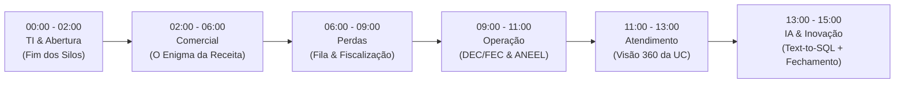

# Roteiro Oficial de Apresentação & Guia de Defesa da Banca

> **Projeto:** V-Energy Grid 360 · Case Final Rocket Lab 2026.2 (Visagio)  
> **Duração Total:** 30 minutos (15 minutos de Apresentação / Live Demo + 15 minutos de Perguntas da Banca Avaliadora)  
> **Público-Alvo da Banca:** Lideranças Executivas da V-Energy (Diretoria Comercial, TI, Operação, Perdas e Atendimento) e Avaliadores Técnicos da Visagio.

---

## 🧭 Glossário Canônico de Siglas

> [!IMPORTANT]
> **Regra de Apresentação:** Nunca mencione uma sigla isolada. Diga sempre o nome por extenso no primeiro segundo em que ela for citada.

| Sigla | Significado Completo | Explicação Rápida de 5 Segundos |
|---|---|---|
| **UC** | **Unidade Consumidora** | O imóvel, loja, residência ou indústria cadastrada que possui um medidor de energia próprio. |
| **DEC** | **Duração Equivalente de Interrupção por Unidade Consumidora** | Quantidade média de horas que os clientes daquela região ficaram sem fornecimento elétrico no período. |
| **FEC** | **Frequência Equivalente de Interrupção por Unidade Consumidora** | Quantidade média de vezes (ocorrências) em que faltou energia para os clientes no período. |
| **GD** | **Geração Distribuída** | Energia elétrica gerada pelo próprio cliente no local de consumo (majoritariamente placas solares fotovoltaicas), abatida da fatura. |
| **ANEEL** | **Agência Nacional de Energia Elétrica** | Agência reguladora federal do setor que estipula metas de continuidade de serviço e aplica penalidades/multas. |
| **PRODIST** | **Procedimentos de Distribuição de Energia Elétrica** | Conjunto de normas técnicas e operacionais estabelecidas pela ANEEL (em especial o Módulo 8 de qualidade da energia). |
| **RBAC** | **Role-Based Access Control** (Controle de Acesso Baseado em Perfis) | Mecanismo de segurança onde cada usuário acessa apenas as telas e ações pertinentes ao seu cargo. |
| **SQL** | **Structured Query Language** (Linguagem de Consulta Estruturada) | Padrão técnico para consultar bancos de dados. A funcionalidade *Text-to-SQL* traduz o português do usuário diretamente para SQL. |
| **OS** | **Ordem de Serviço** | Documento oficial de campo que direciona e autoriza os técnicos a fiscalizarem um medidor suspeito na rua. |
| **kWh / MWh** | **Quilowatt-hora / Megawatt-hora** | Unidades de medida de consumo e fornecimento de energia (1 MWh equivale a 1.000 kWh). |

---

## ⏱️ Roteiro da Apresentação (15 Minutos Cravados)

---

### Bloco 1: Abertura & A Dor da TI (00:00 – 02:00) · 2 min
- **Cliente / Persona:** Patrícia Lins (Diretora de Tecnologia).
- **Problema de Negócio:** Sistemas legados desconectados (CSV, JSON, planilhas à mão) e divergência de números entre as áreas da empresa.
- **Tela a Projetar:**
  1. Tela de Login com **RBAC** (`/login`) — demonstrando a seleção rápida de perfis.
  2. Rota inicial [`/dashboard`](file:///home/miguelsb/workspace/visagio-atividade-v-energy-360/frontend/src/features/executive_dashboard/components/ExecutiveDashboardPage.tsx) (Visão Executiva Global).
- **Roteiro de Fala:**
  > *"Boa tarde aos membros da banca. A V-Energy opera 45 mil Unidades Consumidoras — ou seja, UCs — na Região Metropolitana do Recife, com mais de 2 milhões de leituras e faturas históricas.*  
  > *O grande gargalo da companhia era operar em silos de dados: cadastro em um sistema, medição em outro, ocorrências em planilhas e inspeções manuais em Excel. Cada diretor enxergava um número diferente para o mesmo cliente.*  
  > *Nossa equipe atuou de ponta a ponta: estruturamos um **Pipeline Medalhão no Databricks** — camadas Bronze com dados brutos auditáveis, Silver com regras de limpeza e integridade referencial, e Gold com consolidações de negócio.*  
  > *Essa base alimenta o **V-Energy Grid 360**: uma plataforma web segura com controle de acesso baseado em perfis (RBAC), criando uma fonte única da verdade para todas as gerências."*
- **Diferenciais:**
  - Pipeline de Engenharia de Dados reprodutível via Databricks Workflows (`job.yaml`).
  - Governança de acesso por cargo (Diretoria, Perdas, Operação, Atendimento).

---

### Bloco 2: O Diagnóstico do Diretor Comercial (02:00 – 06:00) · 4 min
- **Cliente / Persona:** Henrique Duarte (Diretor Comercial).
- **Problema de Negócio:** *"A base de clientes cresceu, a tarifa residencial acumulou alta de 10,5%, mas o volume faturado caiu quase 4% e a receita só subiu 8%. Por quê?"*
- **Tela a Projetar:** Rota [`/revenue`](file:///home/miguelsb/workspace/visagio-atividade-v-energy-360/frontend/src/features/revenue/components/RevenueDashboardPage.tsx) (Inteligência Comercial & Decomposição da Receita).
- **O que mostrar na tela:**
  - O gráfico em cascata com a decomposição nos efeitos: Preço, Volume, Mix e Cruzado.
  - O mapa territorial da Região Metropolitana do Recife com os municípios em destaque.
  - O ranking de perdas por bairro e classe.
- **Roteiro de Fala:**
  > *"O Diretor Comercial nos fez a pergunta que originou o projeto: por que a receita cresceu apenas 8% se a tarifa subiu?*  
  > *A resposta está na decomposição analítica que implementamos na tela de Receita:*  
  > *A alta da tarifa média trouxe um ganho positivo de **R$ 22,6 milhões** (efeito-preço). No entanto, o volume de energia faturada caiu **5,1%**, o que destruiu **R$ 8,0 milhões** de receita (efeito-volume).*  
  > *Ao investigar a causa raiz dessa queda de volume, os dados apontam duas razões comprovadas:*  
  > *1. **Geração Distribuída (GD) — Energia Solar:** Das 45 mil UCs, 3,5 mil instalaram painéis solares. Essas unidades são de maior consumo e deixaram de comprar 11,3 mil MWh da rede. A energia solar é responsável por **97,4% de toda a queda de volume líquido** da V-Energy.*  
  > *2. **Fraude Concentrada em 4 Bairros:** Identificamos que a perda de volume residual está concentrada em Iputinga, Macaxeira, Jardim Jordão e Prazeres. Nesses quatro bairros, 96% das fiscalizações confirmaram irregularidades e furto de energia desde maio de 2025. Isso representa **R$ 2,02 milhões** em receita anual passível de recuperação imediata."*
- **Diferenciais:**
  - Decomposição quantitativa exata de receita (Preço, Volume, Mix, Cruzado).
  - Separação clara entre fenômeno de mercado estrutural (solar/GD) e valor financeiro recuperável (fraudes).

---

### Bloco 3: Gestão de Perdas & Fila de Fiscalização (06:00 – 09:00) · 3 min
- **Cliente / Persona:** Rafael Coutinho (Gerente de Perdas).
- **Problema de Negócio:** *"A equipe faz 200 inspeções por mês, mas pouco mais da metade encontra irregularidades. Uma lista desordenada com mil nomes não serve: cada inspeção vazia é um dia de equipe técnica perdido."*
- **Tela a Projetar:** Rota [`/losses`](file:///home/miguelsb/workspace/visagio-atividade-v-energy-360/frontend/src/features/loss_management/components/LossManagementPage.tsx) (Gestão de Perdas & Fila Prioritária).
- **O que mostrar na tela:**
  - A tabela da fila ordenada por score de prioridade, com o motivo da suspeita e a energia estimada a recuperar em kWh.
  - O modal/ação de emissão de Ordem de Serviço (OS).
  - Os botões de ação: exportar CSV da rota de campo e modal de upload do retorno de planilha de fiscalização.
- **Roteiro de Fala:**
  > *"O Gerente de Perdas não pode desperdiçar equipes na rua. Por isso criamos a **Fila de Fiscalização Inteligente**.*  
  > *Em vez de uma lista estática, o algoritmo cruza a queda de consumo histórico com o cadastro de Geração Distribuída — garantindo que clientes honestos que apenas colocaram placas solares não sejam fiscalizados por engano.*  
  > *O gerente visualiza a prioridade, a causa da suspeita e quanto de energia (kWh) podemos recuperar.*  
  > *Com dois cliques, ele gera a Ordem de Serviço (OS) e exporta a lista para o time de rua. Quando os fiscais retornam, o supervisor faz o upload do arquivo preenchido e o sistema atualiza o status de cada inspeção automaticamente, eliminando a digitação manual."*
- **Diferenciais:**
  - Filtro anti-falso-positivo (não fiscaliza quem tem energia solar legalizada).
  - Fluxo completo fechado: Detecção $\rightarrow$ Emissão de OS $\rightarrow$ Exportação de Campo $\rightarrow$ Retorno via Planilha.

---

### Bloco 4: Qualidade da Rede & Indicadores DEC/FEC da ANEEL (09:00 – 11:00) · 2 min
- **Cliente / Persona:** Beatriz Farias (Gerente de Operação).
- **Problema de Negócio:** *"A ANEEL fiscaliza o DEC e o FEC da distribuidora e aplica pesadas multas quando ultrapassamos os limites regulatórios. Onde direcionar a manutenção preventiva?"*
- **Tela a Projetar:** Rota [`/quality`](file:///home/miguelsb/workspace/visagio-atividade-v-energy-360/frontend/src/features/grid_quality/components/GridQualityPage.tsx) (Qualidade da Rede & Indicadores DEC/FEC).
- **O que mostrar na tela:**
  - A evolução histórica das curvas de DEC e FEC ao longo do tempo.
  - A seleção e comparação por alimentador (os circuitos de média tensão).
  - Os cartões de alerta indicando os alimentadores com piores desempenhos e maior risco de penalidade.
- **Roteiro de Fala:**
  > *"Para a Operação da V-Energy, continuidade do serviço significa satisfação do cliente e conformidade regulatória com a ANEEL.*  
  > *Implementamos os cálculos oficiais do PRODIST Módulo 8 da ANEEL para duas métricas essenciais:*  
  > *1. **DEC** — Duração Equivalente de Interrupção por Unidade Consumidora, que reflete as horas médias em que os clientes ficaram sem energia;*  
  > *2. **FEC** — Frequência Equivalente de Interrupção por Unidade Consumidora, que aponta quantas vezes faltou energia.*  
  > *A tela permite que a Beatriz veja não apenas a média global, mas desça até o nível de **alimentador** — os circuitos de média tensão que abastecem os bairros. Conseguimos apontar com precisão quais alimentadores concentram a maioria das interrupções, orientando o orçamento de manutenção preventiva para onde o risco de multa é iminente."*
- **Diferenciais:**
  - Aderência metodológica ao PRODIST (Módulo 8 da ANEEL).
  - Visão granular por alimentador com série histórica de 48 competências.

---

### Bloco 5: Atendimento ao Cliente & Visão 360 da UC (11:00 – 13:00) · 2 min
- **Cliente / Persona:** Camila Barreto (Gerente de Atendimento).
- **Problema de Negócio:** *"O cliente liga com a conta na mão reclamando que veio alta, e o atendente precisa consultar quatro sistemas lentos enquanto o cliente espera na linha."*
- **Tela a Projetar:** Rota [`/customers`](file:///home/miguelsb/workspace/visagio-atividade-v-energy-360/frontend/src/features/customer360/components/Customer360Page.tsx) (Visão 360 da Unidade Consumidora).
- **O que mostrar na tela:**
  - Digitar ou buscar uma UC (ex: `UC-0001` ou uma das UCs dos bairros em foco).
  - O painel integrado em uma única tela: dados cadastrais, comparativo de consumo atual vs. mesmo mês do ano anterior, status do medidor, faturas em aberto, badge de painel solar (GD) e histórico de chamados no call center.
- **Roteiro de Fala:**
  > *"Na ponta do relacionamento com o consumidor, a Gerente Camila Barreto sofria com atendimentos longos e demorados. Nossa tela de **Visão 360 da Unidade Consumidora** resolve essa dor em tempo real.*  
  > *O atendente digita o número da conta e tem um raio-x completo do cliente:*  
  > *Ele visualiza o consumo dos últimos meses lado a lado com o mesmo período do ano anterior. Vê se a rua daquela UC passou por falta de luz recente, se ele possui geração solar própria, faturas pendentes e o histórico de protocolos abertos no call center.*  
  > *Quando o consumidor questiona 'por que minha conta subiu?', o atendente responde em 10 segundos se o consumo em kWh realmente aumentou ou se o valor subiu devido à mudança de bandeira tarifária aprovada pela ANEEL."*
- **Diferenciais:**
  - Tempo de consulta sub-segundo, eliminando navegação entre sistemas legados.
  - Gráfico comparativo de consumo sazonal (mês atual versus mesmo mês do ano anterior).

---

### Bloco 6: Inteligência Artificial Text-to-SQL & Fechamento (13:00 – 15:00) · 2 min
- **Cliente / Persona:** Toda a Diretoria & Patrícia Lins (TI).
- **Problema de Negócio:** *"Como obter respostas imediatas para perguntas de negócio em português sem depender de criar dashboards para tudo e sem esperar dias por chamados na TI?"*
- **Tela a Projetar:** O **Drawer / Assistente de IA** lateral aberto sobre qualquer tela do sistema.
- **O que mostrar ao vivo:**
  1. Digitar uma pergunta em português: *"Qual bairro teve a maior perda de volume faturado residencial no último ano?"*
  2. Mostrar os passos de raciocínio da IA em streaming (FSM), a geração do SQL seguro e a resposta textual fundamentada.
  3. Apontar os **Smart Insights** embutidos nos cards de indicadores do sistema.
- **Roteiro de Fala:**
  > *"Para fechar com chave de ouro: e se um diretor estiver prestes a entrar em uma reunião e precisar de um número que não está em nenhum dashboard pré-definido?*  
  > *Criamos um **Agente Conversacional Text-to-SQL** integrado diretamente ao portal. Ele compreende o vocabulário do dia a dia do setor — como 'conta de luz' ou 'falta de luz' —, formula consultas SQL somente-leitura contra o banco de dados e entrega a resposta analítica instantaneamente.*  
  > *Desenvolvemos o agente sob uma arquitetura de alta confiabilidade: ele é transparente (mostra o SQL e a justificativa para auditoria técnica) e é honesto (se a pergunta não tiver dados no banco, ele informa que não possui a informação em vez de inventar números).*  
  > *O V-Energy Grid 360 entrega, assim, uma solução completa: Engenharia de Dados confiável, Inteligência de Negócio e Inteligência Artificial acessível a qualquer tomador de decisão. Muito obrigado, encerramos a apresentação e estamos prontos para as perguntas da banca."*
- **Diferenciais:**
  - Raciocínio transparente passo a passo com SQL auditável.
  - Blindagem contra alucinações e benchmark automatizado de avaliação de acurácia.

---

## 🛡️ Guia de Defesa da Banca (15 Minutos de Q&A)

As 8 perguntas mais prováveis dos avaliadores técnicos e de negócio, com a resposta exata para garantir a nota máxima:

### 1. Pergunta sobre Arquitetura de Dados:
> *"Por que vocês escolheram SQLite para o banco local do backend em vez de PostgreSQL?"*

- **Como Responder:**  
  *"O SQLite foi uma escolha arquitetural consciente e deliberada para o escopo da área piloto (45 mil UCs e 2,1 milhões de registros). Ele torna a aplicação 100% autocontida, com zero overhead de infraestrutura, sem dependência de serviços externos ou conteinerização pesada para avaliação. Toda a camada Gold foi modelada em terceira forma normal e indexada nas chaves de consulta mais pesadas (competência, alimentador, UC), garantindo tempos de resposta sub-segundo tanto para o backend quanto para o agente de IA."*

---

### 2. Pergunta sobre Segurança e Integridade da IA:
> *"Como vocês garantem que o agente Text-to-SQL não sofre injeção de prompt, não inventa dados (alucinação) e não altera dados no banco?"*

- **Como Responder:**  
  *"Nossa solução possui três barreiras formais de segurança:*  
  *1. **Banco Estritamente Somente-Leitura (Read-Only):** O agente utiliza uma conexão de banco com permissões exclusivas de SELECT, sendo tecnicamente incapaz de executar DROP, UPDATE, INSERT ou DELETE.*  
  *2. **Máquina de Estados Finita (FSM):** O agente valida o SQL contra o schema antes da execução e verifica se o retorno do banco é coerente com a pergunta.*  
  *3. **Golden Dataset de Avaliação:** Temos uma suite automatizada de testes com perguntas reais de negócio que monitora a taxa de acerto do agente e penaliza qualquer tentativa de alucinação."*

---

### 3. Pergunta sobre Geração Distribuída (GD):
> *"Se apenas 3,5 mil UCs possuem energia solar de um total de 45 mil, como ela pode ser responsável por 97% da queda de volume faturado?"*

- **Como Responder:**  
  *"O investimento em geração distribuída concentra-se nos clientes de médio e grande porte (comércios, pequenas indústrias e residências de alto padrão). Embora representem cerca de 7,8% do total de conexões, essas 3,5 mil UCs eram responsáveis por um consumo substancial da concessão. A energia gerada pelo sol é consumida instantaneamente e abatida antes da emissão da fatura. Portanto, o volume faturado caiu 11,3 mil MWh exclusivamente porque esses clientes deixaram de comprar essa energia da rede, explicando matematicamente 97,4% da redução líquida observada."*

---

### 4. Pergunta sobre a Fraude de Energia:
> *"Qual a evidência nos dados de que houve fraude nos quatro bairros críticos a partir de maio de 2025?"*

- **Como Responder:**  
  *"Cruzamos a tabela de medições mensais com os relatórios de inspeções de campo. Nos bairros de Iputinga, Macaxeira, Jardim Jordão e Prazeres, o consumo médio residencial despencou bruscamente a partir de maio de 2025 sem qualquer correlação com instalação de energia solar. Além disso, a equipe de fiscalização registrou 871 inspeções nessas regiões, das quais 835 (96%) confirmaram irregularidades e violações no medidor. O impacto estimado dessa perda não técnica é de 2,7 mil MWh anuais, ou até R$ 2,02 milhões em receita a ser recuperada."*

---

### 5. Pergunta sobre Métricas Regulatórias (DEC/FEC):
> *"Como foi implementado o cálculo do DEC e do FEC no pipeline?"*

- **Como Responder:**  
  *"Calculamos conforme as diretrizes do PRODIST Módulo 8 da ANEEL. Para cada alimentador e competência mensal: o DEC é calculado pela soma do tempo de interrupção multiplicado pelo número de UCs interrompidas dividido pelo total de UCs atendidas pelo alimentador. O FEC segue a mesma lógica, ponderando a quantidade de ocorrências de interrupção. Isso permite que a engenharia de operação compare os alimentadores em bases justas, independentemente do tamanho do circuito."*

---

### 6. Pergunta sobre Metodologia de Decomposição da Receita:
> *"Qual método matemático foi utilizado para separar o efeito-preço do efeito-volume?"*

- **Como Responder:**  
  *"Utilizamos a decomposição clássica de receitas aplicada por segmento (classe × município × bairro). O Efeito Preço isola a variação da tarifa mantendo o volume base constante $[(P_1 - P_0) \times Q_0]$. O Efeito Volume isola a variação física de energia na tarifa base $[(Q_1 - Q_0) \times P_0]$. Além disso, calculamos o Efeito Mix (mudança na proporção entre clientes residenciais, comerciais e industriais) e o Efeito Cruzado. A soma dos quatro efeitos fecha matematicamente na variação total de receita de R$ 12,6 milhões (+8,0%)."*

---

### 7. Pergunta sobre Usabilidade da Equipe de Campo:
> *"A equipe de fiscalização de rua não tem conectividade garantida. Como a solução lida com isso?"*

- **Como Responder:**  
  *"Pensamos exatamente nessa realidade de campo. A tela de perdas possui o botão de 'Exportar Fila', que gera uma planilha estruturada (CSV/Excel) para que os fiscais levem no tablet ou imprimam a rota do dia. Ao retornarem à base, o gestor não precisa redigitar nada: ele utiliza a funcionalidade de 'Importar Retorno de Campo' no portal, que faz o parsing automático e atualiza o status de cada ordem de serviço em lote no banco."*

---

### 8. Pergunta sobre Escalabilidade para Produção:
> *"Se a diretoria aprovar a expansão do Grid 360 para os 2 milhões de clientes do estado de Pernambuco, o que precisaria mudar tecnicamente?"*

- **Como Responder:**  
  *"Nossa arquitetura já foi desenhada para essa escala:*  
  *1. **Engenharia de Dados:** O pipeline Databricks já é escrito em PySpark distribuído, bastando aumentar o número de nós do cluster no job programado.*  
  *2. **Banco de Dados Operacional:** Substituiríamos o SQLite por uma instância gerenciada de PostgreSQL ou CockroachDB com particionamento por município/competência.*  
  *3. **Backend & Frontend:** O backend FastAPI opera sem estado (stateless) e o frontend é uma SPA estática, permitindo escalabilidade horizontal imediata com cache Redis para as rotas analíticas."*

---

## 🎯 Dicas de Postura e Execução da Equipe

1. **Ritmo de Fala:** Fale com tranquilidade e entusiasmo. Ter 15 minutos é tempo suficiente se não houver pausas desnecessárias entre os blocos.
2. **Evite jargões soltos:** Sempre que citar siglas como DEC, FEC ou GD, use o nome por extenso no mesmo momento.
3. **Foco na Tela:** Mantenha o navegador com as abas já carregadas localmente (`http://localhost:5173`) para não depender de conexões instáveis.
4. **Alinhamento do Time:** Todos os membros da equipe devem conhecer as respostas do guia de perguntas; se um membro for arguido sobre uma área específica, ele responde com firmeza e objetividade.
