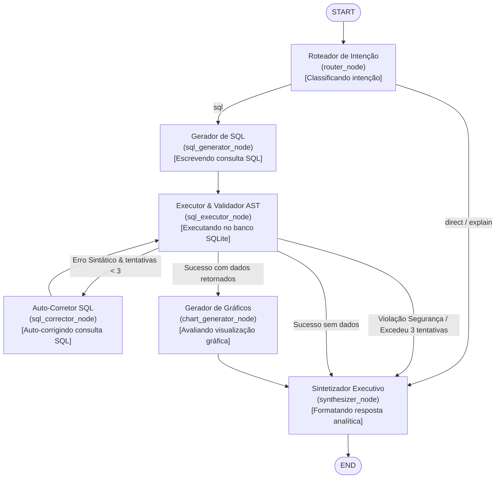

# Especificação Técnica da Máquina de Estados Finita (LangGraph FSM)

Este documento descreve a topologia, ciclo de vida, nós e contratos de transição do Agente Analítico Text-to-SQL do **V-Energy Grid 360**.

---

## 1. Visão Geral da Arquitetura

O agente é orquestrado como um grafo direcionado com transições determinísticas e condicionais utilizando a biblioteca **LangGraph**.
Todo o núcleo reside exclusivamente no módulo `app/agent/`, desacoplado do framework web FastAPI.

### Topologia do Grafo de Execução



---

## 2. Contrato de Estado (`AgentState`)

O estado transita de forma imutável entre os nós através do `AgentState`:

| Campo | Tipo | Reducer | Descrição |
| :--- | :--- | :--- | :--- |
| `messages` | `list[BaseMessage]` | `add_messages` | Histórico de mensagens conversacionais |
| `route` | `Literal["sql", "direct"]` | sobrescrita | Rota classificada pelo nó `router` |
| `thought` | `str \| None` | `append_thought` | Acumulador de reflexões intermediárias dos nós |
| `generated_sql` | `str \| None` | sobrescrita | Query SQL ativa gerada para execução |
| `query_result` | `list[QueryResultRow] \| None` | sobrescrita | Registros tabulares retornados pelo SQLite |
| `error_count` | `int` | sobrescrita | Contador incremental de falhas sintáticas (0 a 3) |
| `last_error` | `str \| None` | sobrescrita | Última mensagem de erro reportada pelo validador ou SQLite |
| `error_category` | `SqlErrorCategory \| None` | sobrescrita | Categoria do erro (`SECURITY_VIOLATION`, `RECOVERABLE_SYNTAX`, etc.) |
| `chart_spec` | `dict[str, Any] \| None` | sobrescrita | Especificação declarativa ChartJsConfigDTO para o frontend |
| `steps` | `list[AgentStepInfo]` | `append_steps` | Lista cronológica de etapas concluídas com latência em ms |
| `command` | `SlashCommandInfo \| None` | sobrescrita | Metadados de comando de barra capturado (`/sql`, `/chart`, etc.) |

### Reducers Especiais

- **`append_steps(existing, new)`**: Reinicializa a lista de etapas sempre que o nó `router` é executado (marcando início de um novo turno conversacional), e anexa/atualiza o tempo em milissegundos de cada nó concluído.
- **`append_thought(existing, new)`**: Suporta `__RESET__` (emitido no início do turno) e concatena blocos reflexivos de diferentes nós (`[Escrevendo consulta SQL]... \n\n [Auto-corrigindo...]`).

---

## 3. Catálogo de Nós e Responsabilidades

### 1. `router_node` (`router`)
- **Papel**: Identifica se a pergunta do usuário exige consulta analítica à base (`sql`) ou se é uma saudação/pergunta conceitual (`direct`).
- **Comandos de Barra**: Processa atalhos explícitos (`/sql`, `/chart`, `/direct`, `/explain`, `/clear`).
- **Transição**: Direciona para `sql_generator` ou salta diretamente para `synthesizer`.

### 2. `sql_generator_node` (`sql_generator`)
- **Papel**: Gera a consulta analítica SQL utilizando o dialeto SQLite a partir do catálogo semântico de regras.
- **Guardrails**: Bloqueia solicitações destrutivas (DROP, DELETE, UPDATE) categorizando-as como `SECURITY_VIOLATION`.
- **Parsing**: Extrai o bloco de raciocínio `<thought>` e o bloco de código ` ```sql `.

### 3. `sql_executor_node` (`sql_executor`)
- **Papel**: Valida a segurança sintática via AST do `sqlparse` (`validate_sql_query`) e executa a query em modo estritamente read-only (`mode=ro`).
- **Bloqueios AST**: Impede injeção de ponto-e-vírgula (múltiplas instruções), acesso a tabelas de catálogo (`sqlite_master`) e comandos DDL/DML destrutivos.
- **Tratamento de Falhas**: Captura falhas operacionais do SQLite e atribui `SqlErrorCategory.RECOVERABLE_SYNTAX`, incrementando `error_count`.

### 4. `sql_corrector_node` (`sql_corrector`)
- **Papel**: Loop reflexivo de autocorreção (self-healing).
- **Entrada**: Consulta com defeito + mensagem de erro do SQLite.
- **Saída**: Nova proposta de query SQL corrigida, retornando para re-execução em `sql_executor` (limite máximo de 3 tentativas).

### 5. `chart_generator_node` (`chart_generator`)
- **Papel**: Avalia se o conjunto de dados retornado possui atributos favoráveis para visualização gráfica (categorias discretas ou séries temporais numéricas) ou intenção explícita (`/chart`, "gráfico", "distribuição").
- **Saída**: Produz payload declarativo `ChartJsConfigDTO` com tipo (`bar`, `line`, `pie`, `doughnut`), rótulos e séries.

### 6. `synthesizer_node` (`synthesizer`)
- **Papel**: Gera a resposta executiva final em Markdown para o usuário.
- **Anti-Alucinação**: Baseia-se estritamente nos dados do bloco `[CONTEXTO DOS DADOS]`.
- **Gráficos**: Caso `chart_spec` esteja presente, insere o marcador ` ```chart ` para que a UI renderize o componente interativo.
- **Zero Vazamento Técnico**: Oculta nomes de tabelas, identificadores de sistema e detalhes de implementação.

---

## 4. Telemetria e Profiling de Nós

Todos os nós são encapsulados pelo wrapper funcional `_wrap_node`:
- Medição de tempo de alta precisão via `time.perf_counter()`.
- Criação de `AgentStepInfo`:
  ```json
  {
    "node": "sql_generator",
    "label": "Escrevendo consulta SQL",
    "status": "done",
    "duration_ms": 385
  }
  ```
- Propagação das etapas e pensamentos nos metadados `additional_kwargs` da `AIMessage` final.

---

## 5. Fronteiras de Arquitetura (Agent vs Features)

```
[app/agent/]                                 [app/features/agent/]
Lógica Pura de IA                            Integração FastAPI & Web
-----------------                            ------------------------
- StateGraph compilado                       - Rota POST /chat/stream
- Reducers e TypedDicts                      - Despacho SSE (event_dispatcher)
- Prompts, Tools e Nós                       - Conversão de deltas para eventos
- Zero dependências de FastAPI / HTTP        - Schemas DTO de API
```
